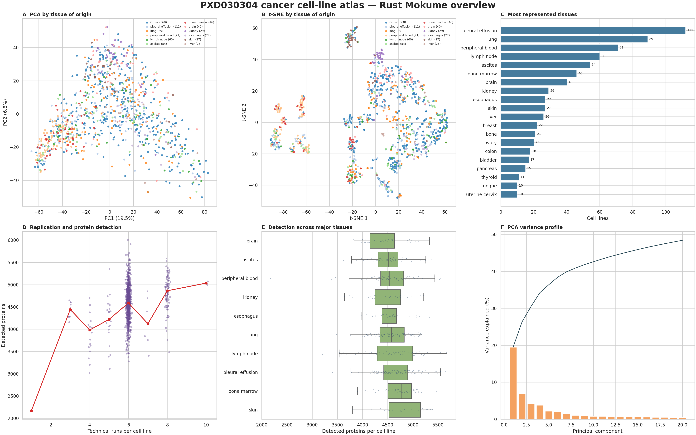
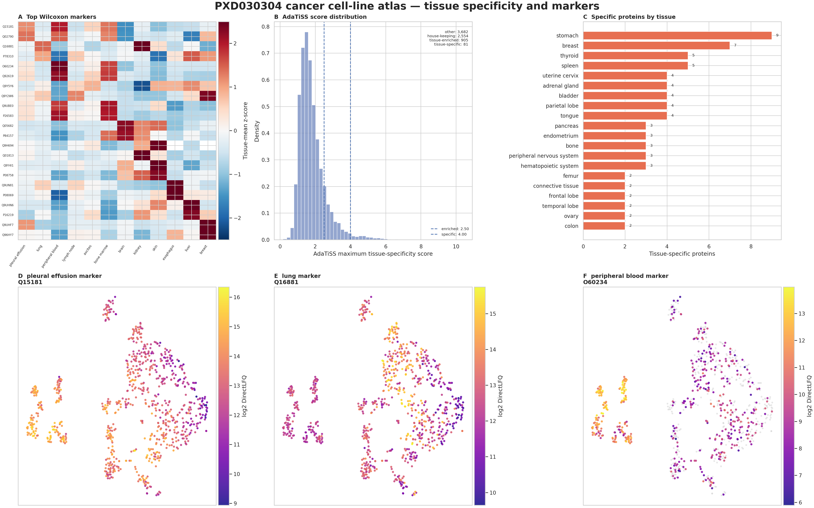
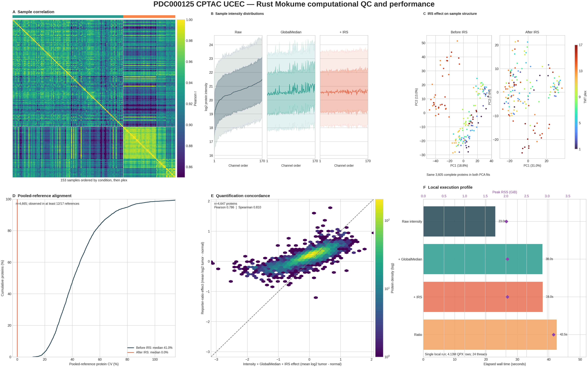

# mokume

[](https://github.com/bigbio/mokume/actions/workflows/rust.yml)
[](https://github.com/bigbio/mokume/actions/workflows/python-app.yml)
[](https://github.com/bigbio/mokume/actions/workflows/wheels.yml)
[](https://badge.fury.io/py/mokume)


**mokume** is a comprehensive proteomics quantification toolkit: it turns
peptide-level mass-spectrometry intensities into protein expression matrices,
with built-in normalization, imputation, batch correction, and differential
expression. It supports piBAQ, TopN, MaxLFQ, and DirectLFQ quantification, is
designed for the [quantms](https://github.com/bigbio/quantms) ecosystem, and
works as both a Python library and a command-line tool.

mokume is an evolution of [ibaqpy](https://github.com/bigbio/ibaqpy), extended
well beyond the original iBAQ workflow to a broader range of quantification,
normalization, and differential-expression methods.

## Why "mokume"?

*[Mokume-gane](https://en.wikipedia.org/wiki/Mokume-gane)* (木目金, "wood-grain
metal") is a Japanese metalworking technique that fuses layers of different
metals into a single piece with a distinctive flowing pattern. mokume does the
same with proteomics data: it melds many noisy, overlapping peptide intensities
into one coherent protein expression profile.

## Repository layout

This repository ships **two implementations of mokume in one place**, following
the multi-language monorepo convention used by projects such as
[Apache Arrow](https://github.com/apache/arrow) (one top-level folder per
language):

```text
mokume/
├── .agents/         # Codex marketplace metadata
├── .claude-plugin/  # Claude Code marketplace metadata
├── docs/            # one shared documentation site (mkdocs)
├── plugins/         # Codex/Claude plugin (shared skill + MCP + knowledge)
├── python/          # the pure-Python implementation — `mokume-py`
└── rust/            # the default Rust-backed `mokume` wheel
```

- **`rust/`** — the default `mokume` distribution (`pip install mokume`) and
  **leading implementation** of the native computation commands. Its Rust
  kernel is exposed through the in-process `mokume._mokume` extension.
- **`python/`** — the pure-Python `mokume-py` distribution (`pip install
  mokume-py`). It provides readable, independently maintained implementations
  and compatibility baselines for covered kernel behavior.

Both expose the same four computation command names, with different support
levels. **mokume is Rust-first**: new computation lands in the Rust kernel, and
overlapping supported paths are parity-tested where coverage exists. See
[Maintenance scope](#maintenance-scope) below. The measured runtime/memory
trade-off is workload-specific: on the current `sum` parity benchmark the Rust
path is about 1.4–1.5× faster, while using about 6.2–8.3× less peak memory.
See [docs/architecture.md](docs/architecture.md) for the measured values.

## Installation

Install the default Rust-backed distribution:

```bash
pip install mokume
```

The base wheel contains the native quantification, normalization, imputation,
batch-correction, and differential-expression kernel. It also installs pyOpenMS
(including pyOpenMS's numpy, pandas, and matplotlib dependencies); piBAQ reads
that runtime's complete protease catalog and passes the theoretical peptide map
into the Rust kernel. Extras select Mokume's additional periphery stacks:

```bash
pip install "mokume[analysis]"   # plots, reports, QC, comparison, and missforest
pip install "mokume[tissuemap]"  # tissue-specificity pipeline
pip install "mokume[plugin]"     # local MCP service used by the Mokume Plugin
pip install "mokume[all]"        # all Python periphery dependencies
```

The installed `mokume --help` lists both the Rust-native compute commands and
the optional wheel workflows. After installing the matching extra, run
`mokume plot tsne`, `mokume tissuemap`, `mokume plot de`, or
`mokume interactive-report` directly.

Mokume and the optional Plugin/MCP workflow require Python 3.10 or newer.

For the separate pure-Python implementation, use `pip install mokume-py`; its
base install also includes pyOpenMS and piBAQ calls pyOpenMS digestion directly.
Do not install `mokume` and `mokume-py` together because both provide the
`mokume` import package and console command. Agentic recommendation belongs to
the default `mokume` distribution and its installable plugin, not `mokume-py`.
See [Installation](docs/installation.md).

## Quick start

Run the full pipeline from a quantms feature table to a protein matrix:

```bash
mokume quantify features2proteins \
  --parquet features.parquet \
  --sdrf samples.sdrf.tsv \
  --quant-method maxlfq \
  --output proteins.csv
```

Add differential expression by passing one or more contrasts; a DE option
enables the stage directly:

```bash
mokume quantify features2proteins \
  --parquet features.parquet \
  --sdrf samples.sdrf.tsv \
  --quant-method maxlfq \
  --de-contrast "Treatment" "Control" \
  --output proteins.csv --de-output de_results.csv
```

The wheel runs the same kernel in-process from Python:
`mokume.features2proteins(parquet="features.parquet", sdrf="samples.sdrf.tsv", quant_method="maxlfq", output="proteins.csv")`.
Each keyword argument maps to a CLI flag; see [Rust wheel](docs/rust-wheel.md).

Both computation implementations expose the `features2proteins` command, but
their CLIs and supported options are maintained separately. For scripting, the
pure-Python `mokume-py` package (installed instead of `mokume`) exposes
component APIs — for example, quantifying a peptide table:

```python
import pandas as pd
from mokume.quantification import TopNQuantification

# columns: ProteinName, PeptideCanonical, NormIntensity, SampleID
peptides = pd.read_csv("peptides.csv")

# TopN protein quantification; MaxLFQ / piBAQ / DirectLFQ share the .quantify interface
proteins = TopNQuantification(n=3).quantify(peptides)
```

In `mokume-py`, normalization, imputation, and differential expression have the
same component-style API (see [below](#differential-expression) and the
[Python package API reference](docs/reference/python-api-package.md)).

## Running different analyses

One `features2proteins` command drives every workflow — swap a flag to change
the analysis. Each snippet is a complete run; deeper options are one link away.

**Relative quantification** — pick a method with `--quant-method` (`maxlfq`,
`directlfq`, `top3` / `top5` / any `top<N>`, `sum`, ...):

```bash
mokume quantify features2proteins \
  --parquet features.parquet --sdrf samples.sdrf.tsv \
  --quant-method maxlfq \
  --output proteins.csv
```

**Absolute expression (piBAQ)** — add a FASTA to get piBAQ / TPA /
ProteomicRuler abundances instead of relative intensities:

```bash
mokume quantify features2proteins \
  --parquet features.parquet --sdrf samples.sdrf.tsv \
  --quant-method pibaq --fasta proteome.fasta \
  --output proteins_pibaq.csv
```

**Differential expression** — append one or more contrasts to any of
the above (see [Differential expression](#differential-expression) for methods
and FDR control):

```bash
mokume quantify features2proteins \
  --parquet features.parquet --sdrf samples.sdrf.tsv \
  --quant-method maxlfq \
  --de-contrast "Treatment" "Control" \
  --output proteins.csv --de-output de_results.csv
```

**Pure-Python pipeline** (`mokume-py`) — express the workflow as a
configurable object that returns a `QpxDataset` you can inspect level by level:

```python
from mokume.pipeline.config import PipelineConfig, InputConfig, QuantificationConfig
from mokume.pipeline.runner import run_pipeline

config = PipelineConfig(
    input=InputConfig(parquet="features.parquet", sdrf="samples.sdrf.tsv"),
    quantification=QuantificationConfig(method="maxlfq"),
)
proteins = run_pipeline(config).get_level("proteins")  # proteins x samples matrix
```

Runnable examples per analysis: [quantification methods](docs/examples/quantification.md)
· [absolute expression / piBAQ](docs/examples/absolute-expression.md)
· [differential expression](docs/examples/differential-expression.md)
· [full Python pipeline](docs/examples/pipeline.md)
· [CPTAC UCEC total proteome](docs/examples/cptac-ucec.md)
· [PXD030304 cell-line atlas](docs/examples/pxd030304-cell-lines.md).

## Commands

| Command | What it does |
| --- | --- |
| `quantify features2proteins` | Full pipeline: feature table → protein quantification matrix |
| `quantify features2peptides` | Aggregate features to peptide-level intensities |
| `quantify peptides2protein` | Roll peptide intensities up to protein quantities |
| `correct-batches` | Standalone ComBat batch correction (with AnnData export) |

## Quantification and methods

`features2proteins` runs these stages in order:

<p align="center">
  
</p>

- **Quantification:** `maxlfq`, `directlfq`, `pibaq`, `top<N>` (`top3`, `top5`,
  `top10`, ... — the N is part of the method name), `sum` (also `median`,
  `ratio`, `abd`, `intensity`, `peptide-count`, `spectral-count`). `peptide-count`
  counts distinct canonical peptides from feature QPX; true `spectral-count`
  pairs PSM QPX (`--psm`) with its feature QPX (`--parquet`) and counts each
  unique QPX `psm_id`. piBAQ requires a FASTA; TopN, MaxLFQ, and Sum do not.
  The two count methods reject intensity normalization and IRS rather than
  silently accepting no-op scaling.
- **Normalization:** run-level and sample-level options including `median`,
  `quantile`, `rlr`, and `loess`.
- **Imputation:** a wide set of imputers, from simple (`mindet`, `knn`) to
  model-based (`qrilc`, `impseq`).
- **Batch correction:** native ComBat (parametric, non-parametric, and
  covariate-aware) that removes technical batch effects while preserving
  biological signal.
- **Differential expression:** `limma`, `deqms`, `rots`, `limrots`,
  `proda`, and an ensemble (see below).

The full catalog lives in the [user guide](docs/user-guide/) and the
[method concepts](docs/concepts/) pages.

## Differential expression

mokume ships several differential-expression methods behind one interface, with
Benjamini-Hochberg (default), IHW, BKY, or Storey FDR control and fixed or
data-driven effect-size gates:

- **LimROTS** — limma moderation with a ROTS bootstrap-optimized statistic; the
  best sensitivity on MaxLFQ data.
- **DEqMS** — peptide-count-weighted eBayes; controls false positives better on
  noisier DirectLFQ data.
- **proDA** — probabilistic dropout-aware DE that models missing values as
  informative, not random.
- **limma**, **ROTS**, and a consensus **ensemble** are also wired.

With `mokume-py`, the individual methods are available as a Python component:

```python
from mokume.analysis import DifferentialExpression

de = DifferentialExpression(method="limrots")
results = de.run_comparisons(
    protein_df,
    sample_to_condition,
    contrasts=[("Treatment", "Control")],
)
# results -> {"Treatment-Control": DataFrame with log2FC, pvalue, adj_pvalue, ...}
```

LimROTS and ROTS report their own permutation-based FDR, so requesting IHW does
not overwrite it. See [docs/concepts/differential-expression.md](docs/concepts/differential-expression.md).

## AI-assisted method selection

The installable Mokume Plugin lets Codex or Claude Code inspect a protein
matrix, bind traceable benchmark evidence, and evaluate bounded normalization,
imputation, and differential-expression candidates through the Rust kernel.
For this Plugin path, the host owns the model and credentials; Mokume receives
no host API key.
Its bundled local MCP server starts automatically when the plugin is enabled.
With ground truth it ranks the five Score A metrics by benchmark mean rank;
without ground truth it reports
exploratory diagnostics without selecting a winner. See the
[Mokume Plugin guide](docs/user-guide/agentic-plugin.md).

## How it works

mokume's computation is available through two implementations with overlapping
functionality:

- the leading Rust compute kernel, shipped in the default `mokume` wheel with
  an in-process Python API and an installed `mokume` console command; and
- the pure-Python `mokume-py` distribution, which provides independently
  maintained implementations for extension and interactive analysis.

The Mokume Plugin is a separate installable host bundle. It contributes a
skill, a traceable knowledge snapshot, and automatic local MCP configuration;
the MCP tools call the default wheel's Rust-backed matrix APIs.

The wheel's Python API and console command share one compiled kernel, so a
result computed through either interface is identical. On the 2026-10-18
`sum` parity rerun (24 threads, one warm-up, median of three measured runs),
Rust/Python wall times were 6.43/9.38 seconds on PXD003539 and 11.84/16.48
seconds on PXD004701. Peak memory was 0.73/4.51 GiB and 0.80/6.58 GiB,
respectively. Protein sets, sample sets, and all 448,380/614,308 matrix cells
were exact. For the full design, see [docs/architecture.md](docs/architecture.md).

## Maintenance scope

mokume keeps its computation in two codebases — the Rust kernel (`rust/`) and the
pure-Python package (`python/`) — which expose the same four computation commands
with different support levels. To keep overlapping behavior from drifting,
mokume is **Rust-first**:

- **The Rust kernel is the leading implementation.** New behavior, supported
  options, and validation for the native computation commands are defined there
  first. Where Python implements the same capability, it follows the shared
  public contract.
- **New computation is written in Rust first.** A feature that touches the
  computation commands ships once the Rust crates and their tests have it; a
  pure-Python counterpart is optional and can follow later when users or
  maintainers need it.
- **The pure-Python computation package is added value.** It is kept public and
  usable so individual functions can be plugged into Python pipelines and so it
  can provide readable implementations and compatibility baselines for covered
  behavior — not as the place new computation lands first.

| Computation command | Rust kernel (`rust/`) | Pure-Python package (`python/`) |
| --- | --- | --- |
| `features2proteins` | ✅ Leading — authoritative | ✅ Added value · parity-checked where covered |
| `features2peptides`  | ✅ Leading — authoritative | ✅ Added value · best-effort |
| `peptides2protein`   | ✅ Leading — authoritative | ✅ Added value · best-effort |
| `correct-batches`    | ✅ Leading — authoritative (native ComBat) | ✅ Added value · best-effort |

This scope covers the **computation implementations only**. The Python pipeline
API and its shared post-processing, plotting, reporting, and TissueMap remain
periphery. The installable Mokume Plugin is an interface over the default
Rust-backed wheel, rather than an additional computation backend. Full policy:
[docs/maintenance-scope.md](docs/maintenance-scope.md).

## Example: a tissue proteome atlas

A full run on real data: **PXD030304**, 228.72 million DIA-NN QPX feature rows
from 5,798 label-free runs representing 949 cancer cell lines. Native Rust
DirectLFQ writes the 9,530 × 949 protein matrix; Mokume's Python periphery reads
that result to embed the samples, inspect detection depth, score AdaTiSS tissue
specificity, and find tissue markers.

<p align="center">
  
</p>

*All 949 cell lines: PCA and t-SNE by tissue of origin, tissue representation,
technical-run depth versus protein detection, detection across major tissues,
and the PCA variance profile. PC1 explains 19.5% and PC2 6.8% of the variance.*

<p align="center">
  
</p>

*Biological panels use the 815 cell lines in the 34 tissues with at least five
samples: Wilcoxon marker profiles, AdaTiSS scores, tissue-specific protein
counts, and three marker-expression maps. The complete Rust command, renderer,
result interpretation, and numerical comparison with the previous kernel are in
[docs/examples/pxd030304-cell-lines.md](docs/examples/pxd030304-cell-lines.md).*

## Example: CPTAC UCEC total proteome

A real multi-plex TMT run on
**[PDC000125](https://pdc.cancer.gov/pdc/study/PDC000125)**: 4.13 million QPX
feature rows from 408 fractions across 17 plexes. mokume sums linear reporter
abundance, corrects sample-wide loading shifts with global-median normalization,
aligns plexes through their pooled reference channels with IRS, and applies a
65% condition-wise coverage gate. The final matrix contains 4,665 proteins
across 104 primary tumors and 49 solid-tissue normals.

<p align="center">
  
</p>

*The same overview grammar as the cell-line atlas: biological PCA, secondary
design structure, cohort composition, technical completeness, group-level
detection, and the PCA variance profile. PC1 explains 31.0% and PC2 explains
7.6% of the variance; the normal-only plex 17 remains visible as a study-design
limitation.*

<p align="center">
  
</p>

*The computational layer uses four fresh Rust runs on the same QPX input:
sample correlation, the Raw → GlobalMedian → IRS intensity trajectory, PCA
before and after IRS, pooled-reference alignment, intensity-versus-ratio effect
concordance, and a transparent single-workstation execution profile. The
timing panel is a local 24-thread measurement, not a cross-machine benchmark.*

<p align="center">
  
</p>

*The matching biological layer: strongest DE profiles, limma volcano and MA
plots, plus observed expression for three representative proteins. There are
611 up-regulated, 640 down-regulated, and 3,414 unchanged proteins at BH
FDR < 0.05 and |log2FC| > 0.5. The complete, copy-pasteable workflow is in
[docs/examples/cptac-ucec.md](docs/examples/cptac-ucec.md).*

## Documentation

- [Documentation home](docs/index.md)
- [Quick start](docs/quickstart.md)
- [Installation](docs/installation.md)
- [User guide](docs/user-guide/) · [Method concepts](docs/concepts/)
- [Rust wheel](docs/rust-wheel.md) · [Architecture](docs/architecture.md) · [Maintenance scope](docs/maintenance-scope.md)
- [Benchmarks](benchmarks/)

## Citation

mokume is part of the [quantms](https://github.com/bigbio/quantms) ecosystem and
evolves [ibaqpy](https://github.com/bigbio/ibaqpy). Until a dedicated mokume
paper is available, please cite ibaqpy and quantms — see [CITATION.cff](CITATION.cff)
and those repositories for current citation details and DOIs.

## Credits, contributing, and license

mokume is developed by the [bigbio](https://github.com/bigbio) community as part
of the quantms ecosystem. Contributions are welcome; see
[the community guide](docs/community.md) for development setup and guidelines.

Licensed under the [MIT License](LICENSE).
