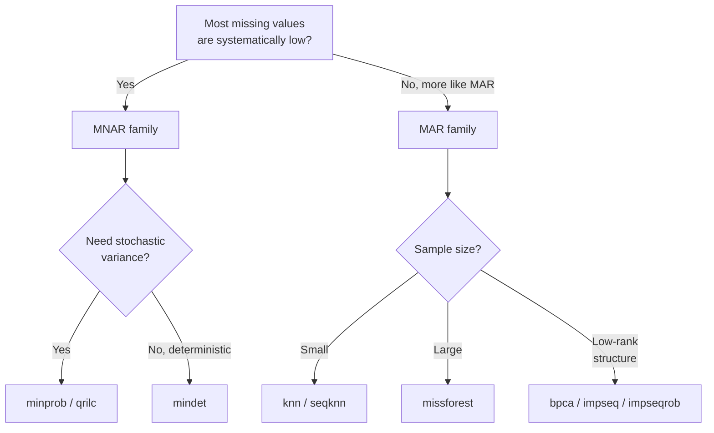

# Missing Value Imputation

Mass-spectrometry-based proteomics produces sparse intensity matrices: a
non-trivial fraction of cells are missing because either the analyte was
absent below the detection limit (**MNAR** — missing not at random) or
detection was stochastic / instrument-dependent (**MAR** / **MCAR**).
Different downstream analyses (PCA, batch correction, DE) tolerate
missingness very differently, so imputation is often required.

mokume runs imputation in the native Rust kernel **after** coverage
filtering and **before** batch correction in the `features2proteins`
pipeline (selecting `--impute-method` enables it), plus a wheel-only standalone helper
`mokume.impute` for the methods the kernel does not reproduce.

## Pipeline Position

```text
LoadingStage → QuantificationStage → IRS → coverage filter
             → ImputationStage → BatchCorrection → DE
```

The protein matrix is converted to **log2 space** before imputation and
back to linear space afterwards. This is essential for censored-aware
methods (MinProb / MinDet / QRILC) which assume log-normal intensities.

## Method Categories

| Family | Methods | Assumption |
|--------|---------|------------|
| **Censored / MNAR** | `minprob`, `mindet`, `qrilc` | Missing values are systematically low |
| **Local-similarity (MAR)** | `knn`, `seqknn` | Similar samples / proteins share intensity patterns |
| **Iterative model (MAR)** | `missforest` | Missingness depends on observed values |
| **Latent / matrix-completion** | `bpca`, `gms`, `impseq`, `impseqrob` | A low-rank structure underlies the matrix |

## Censored-Aware Methods

### MinProb

Follows imputeLCMD `impute.MinProb`: each missing value of a sample is
drawn from a normal centred on a low quantile of that sample:

$$x \sim \mathcal{N}\left(q_{\text{low}},\ (\text{tune\_sigma} \cdot \text{sd}_{\text{median}})^2\right)$$

where `q_low` is the `--impute-quantile`-quantile of the sample's observed
log2 intensities, `sd_median` is the median standard deviation of the
proteins observed in more than half of the samples and `tune_sigma` is
`--impute-tune-sigma`. `--impute-seed` fixes the draws.

```bash
mokume quantify features2proteins -p data.parquet -o out.csv \
    --impute-method minprob \
    --impute-quantile 0.01 --impute-tune-sigma 1.0 --impute-seed 42
```

### MinDet

Replaces all missing values in a sample with a single deterministic
quantile of that sample's observed values. More conservative than
MinProb because it does not introduce sample-level variance.

```bash
mokume quantify features2proteins -p data.parquet -o out.csv \
    --impute-method mindet --impute-quantile 0.01
```

### QRILC

Quantile Regression Imputation of Left-Censored data (imputeLCMD
`impute.QRILC`): fits a normal per sample by regressing the observed
quantiles on the standard-normal quantiles they would have if the missing
fraction were the left tail, then draws replacement values from that normal
truncated at the missing fraction. Theoretically more principled than
MinProb when the MNAR assumption holds. `--impute-tune-sigma` scales the
fitted SD and `--impute-seed` fixes the draws.

```bash
mokume quantify features2proteins -p data.parquet -o out.csv \
    --impute-method qrilc
```

## Local-Similarity Methods

### KNN

`sklearn.impute.KNNImputer` with `nan_euclidean` distance. Works on
per-protein vectors across samples; suitable when proteins co-vary.

```bash
mokume quantify features2proteins -p data.parquet -o out.csv \
    --impute-method knn --impute-n-neighbors 5
```

### SeqKNN

Sequential KNN orders proteins by missingness and imputes iteratively,
using already-imputed values as features for the next step (Kim et al.
2004). Runs natively in the Rust kernel.

```bash
mokume quantify features2proteins -p data.parquet -o out.csv \
    --impute-method seqknn --impute-n-neighbors 5
```

## Iterative Model Methods

### missForest

Random-forest-based iterative imputation (Stekhoven & Buehlmann 2011).
Generally the most accurate of the MAR family but the slowest.

!!! warning "Wheel-only"
    `missforest` is **not** ported to the Rust kernel — it wraps scikit-learn's
    `IterativeImputer` driven by `RandomForestRegressor`, whose tree-building and
    RNG cannot be reproduced cross-language. The Rust compute CLI does not
    advertise this method; use the wheel's Python analysis API:
    `mokume.impute(matrix, method="missforest")` (`pip install mokume[analysis]`).

## Latent / Matrix-Completion Methods

### BPCA

Bayesian PCA imputation (Oba et al. 2003). Fits a probabilistic low-rank
factorisation via EM and uses the model to predict missing entries.
Runs natively in the Rust kernel. In the OpDEA benchmark BPCA is a top-tier
imputer (best on MaxQuant TMT).

```bash
mokume quantify features2proteins -p data.parquet -o out.csv \
    --impute-method bpca
```

### GMS

Gaussian Mixture Sampling — fits a two-component mixture model to each
sample's observed values and fills its missing entries with the centre of
the lower component.
Runs natively in the Rust kernel. In the OpDEA benchmark GMS is the
best-performing imputer for FragPipe TMT data.

```bash
mokume quantify features2proteins -p data.parquet -o out.csv \
    --impute-method gms
```

### impSeq / impSeqRob

Sequential regression imputation following the variable-by-variable
ordering of the rrcovNA package; `impseqrob` uses MCD-based robust
regression to resist outliers. Both run natively in the Rust kernel.

```bash
mokume quantify features2proteins -p data.parquet -o out.csv \
    --impute-method impseq   # or: impseqrob
```

## Choosing a Method



Practical defaults:

- **DIA / DirectLFQ**: `mindet` (low missingness, mostly MNAR)
- **DDA-LFQ**: `minprob` for biology-driven MNAR, `knn` for technical MAR
- **TMT**: usually no imputation; if needed, `bpca` (MaxQuant) or `gms` (FragPipe) rank best in the OpDEA benchmark, otherwise `seqknn`
- **Single-cell proteomics**: `knn` or `missforest`

## Standalone API

The wheel runs the kernel methods on a row-major linear-intensity matrix
with `mokume.impute_matrix`, and the scikit-learn based methods (`knn`,
`mean`, `median`, `seqknn` and the wheel-only `missforest`) on a wide
protein matrix CSV (or DataFrame) with `mokume.impute`, available with
`pip install mokume[analysis]`:

```python
import mokume

# Row-major linear intensities; None marks a missing value
filled = mokume.impute_matrix(values, "minprob", quantile=0.01, tune_sigma=1.0, seed=42)

# Wide matrix: rows=proteins, columns=samples
mokume.impute("proteins.csv", method="knn", n_neighbors=5, output="imputed.csv")
mokume.impute("proteins.csv", method="missforest", output="imputed.csv")
```

The same methods run inside the pipeline via `--impute-method <name>`,
which is the single-sourced path for the kernel-ported imputers.

## Caveats

- **Imputation is not free**: it introduces dependencies between samples
  that downstream tests may underestimate. Always report the imputation
  method and parameters.
- **Censored-aware methods inflate variance** in low-abundance proteins.
  Pair them with conservative FDR control.
- **MAR methods assume the MAR mechanism**; if missingness is dominated
  by left-censoring, MAR methods systematically over-estimate low
  intensities.
